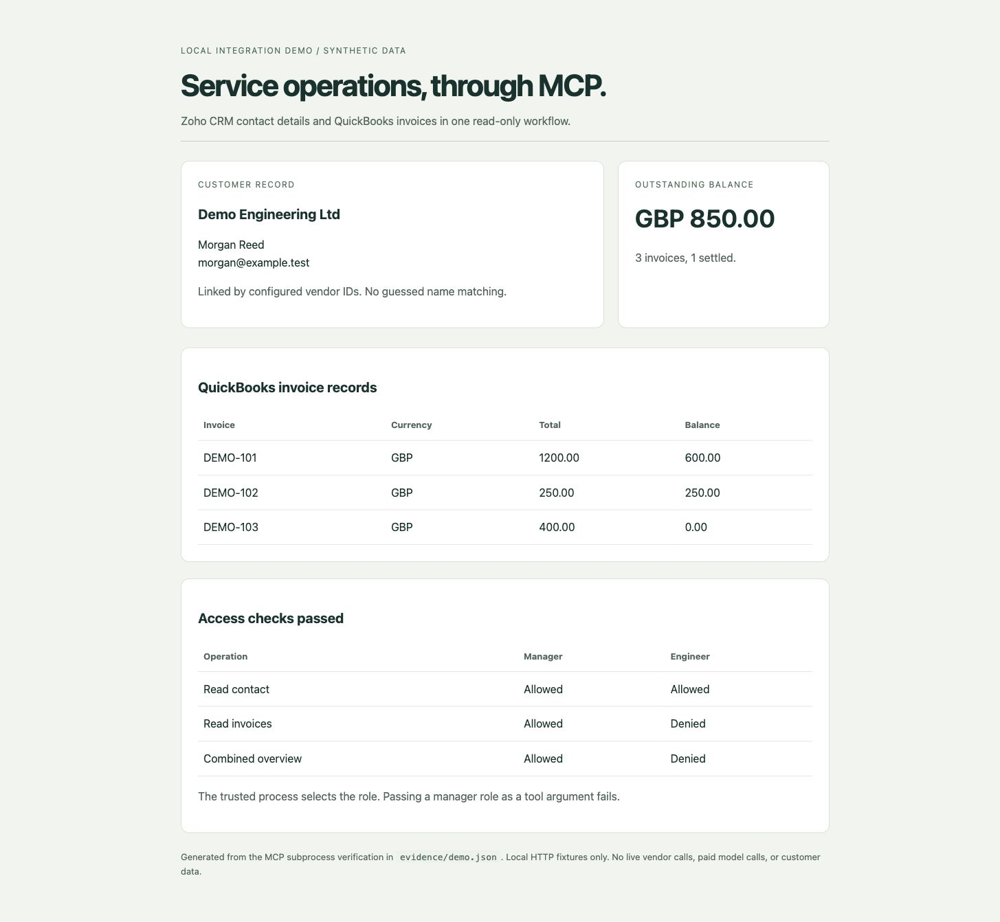

# Service ops MCP demo

Read a customer's Zoho CRM details and QuickBooks invoices through MCP. Get one structured summary and a local HTML report.

The default demo runs locally with synthetic records. It needs no API keys, model calls, paid plan, or cloud deployment. The provider code also has an authenticated read-only mode for Zoho Developer Edition and a QuickBooks sandbox.

Live vendor calls have not been verified with real credentials. This is a new integration demo, not a claim of previous client delivery.



## Run the demo

Install Python 3.11 or newer and [uv](https://docs.astral.sh/uv/getting-started/installation/). Then run these commands from the repository folder.

```sh
uv sync --locked
uv run python -m service_ops.demo
```

The demo launches the MCP server as a subprocess and calls its tools through the official MCP client. It checks the customer summary and verifies that an engineer cannot read invoice data.

Open `evidence/report.html` to see the report. `evidence/demo.json` contains the structured results from the protocol run. All customer records in these files are synthetic.

## What works

- Zoho CRM contact reads and QuickBooks sandbox customer and invoice reads.
- OAuth token refresh, including persisted QuickBooks refresh token rotation.
- A customer summary with invoice balances kept separate by currency.
- Server-selected roles, with manager-only access to financial tools.
- Bounded pagination, timeouts, one bounded retry for temporary provider errors, and redacted error messages.
- A local report built from the MCP tool result. It preserves available records when a provider fails and labels incomplete invoice totals as partial.

| Tool | Sales | Engineer | Manager |
| --- | --- | --- | --- |
| `get_contact` | Yes | Yes | Yes |
| `get_invoices` | No | No | Yes |
| `get_customer_overview` | No | No | Yes |

The server owner selects the role at startup. The model cannot request a different role as a tool argument. This demonstrates a permission boundary within one local process. It is not a shared multi-user login system.

## Check the code

```sh
uv run pytest
uv run ruff check .
uv run ruff format --check .
uv run python -m service_ops.demo
```

The tests use vendor-shaped HTTP responses. The same URL builders, headers, response parsers, OAuth code, and service methods run in fixture and live modes. See [verification status](docs/verification.md) for the actual checks and limits.

## Use an MCP client

For a client that accepts an `mcpServers` configuration, use this entry. Replace the directory with your checkout's absolute path.

```json
{
  "mcpServers": {
    "service-ops-demo": {
      "command": "uv",
      "args": [
        "run",
        "--directory",
        "/absolute/path/to/service-ops-mcp-demo",
        "python",
        "-m",
        "service_ops.server"
      ],
      "env": {
        "SERVICE_OPS_MODE": "fixture",
        "SERVICE_OPS_ROLE": "manager"
      }
    }
  }
}
```

Ask the client to call `get_customer_overview` for customer key `demo-engineering`. The local demo command proves the tool protocol without a language model. No authenticated Claude session was used for the saved verification run.

## Test with developer accounts

[Zoho Developer Edition](https://www.zoho.com/crm/developer/docs/dev-edition.html) is free for testing. Intuit provides [QuickBooks sandbox companies](https://static.developer.intuit.com/output_html/qbo/docs/develop/sandboxes/manage-your-sandboxes.html) for development. This repository does not start subscriptions or call a paid model API.

1. Create your own developer accounts and authorize your own test organizations using the vendors' developer tools.
2. Copy `.env.example` to `.env`. Enter credentials locally. Do not paste tokens into an issue or commit them.
3. Create a private customer mapping file with the Zoho contact ID and QuickBooks customer ID for the same test business. Set its absolute path in `SERVICE_OPS_CUSTOMERS_FILE`.
4. Set `SERVICE_OPS_MODE=live-readonly` and a private absolute `SERVICE_OPS_TOKEN_DIR` outside the checkout. Set `ZOHO_REGION` to the region of your developer organization.
5. Start the server with `uv run --env-file .env python -m service_ops.server`. Connect your MCP client and call a tool with a mapped customer key.

The mapping file has this shape. Replace the sample IDs with records from your own test organizations.

```json
[
  {
    "key": "demo-engineering",
    "zoho_contact_id": "5725767000000412001",
    "quickbooks_customer_id": "42"
  }
]
```

Use the Zoho scope `ZohoCRM.modules.contacts.READ`. QuickBooks uses the vendor's `com.intuit.quickbooks.accounting` scope, which can grant broader access than these read-only tools use. Keep that credential limited to your sandbox.

If QuickBooks omits an invoice's `CurrencyRef`, set `QUICKBOOKS_HOME_CURRENCY` to the test company's verified home currency. Without that explicit value, the server returns `missing_currency` rather than guessing a currency.

The initial authorization and token provisioning happen in the vendor developer tools. This demo implements token refresh, not a hosted OAuth consent callback.

Use only one server process per token directory. Token files have private file permissions and atomic replacement, but the demo does not coordinate refreshes across multiple processes.

The QuickBooks API host is fixed to the sandbox. Zoho uses regional developer API hosts. Business tools only issue GET requests. The only external POST requests refresh OAuth tokens. There are no invoice creation, payment, deletion, or arbitrary query tools.

## Scope

This first demo covers the Zoho and QuickBooks integration slice of a service-business workflow. Synchroteam, call transcription, coaching, engineering manual search, and shared user authentication are not implemented. Connecting a tool through MCP does not itself prove Claude's answer quality.

The repository contains no real customer records or client accounts. See the [design notes](docs/design.md) and [official API references](docs/sources.md).

MIT licensed.
